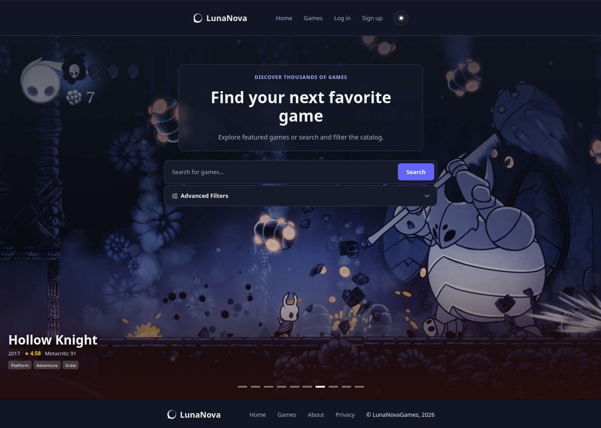
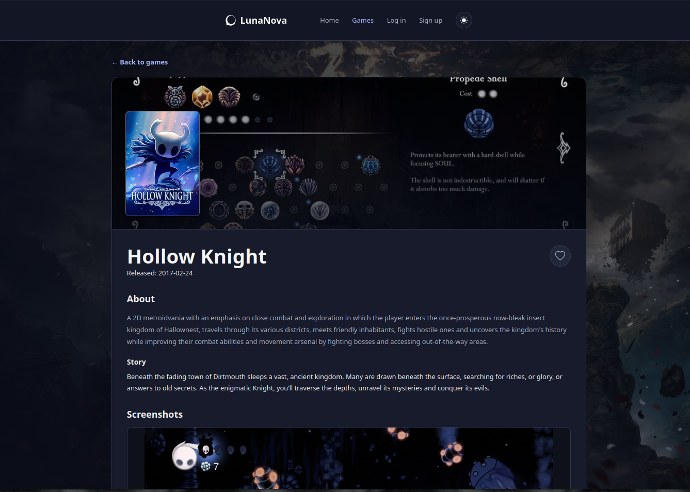
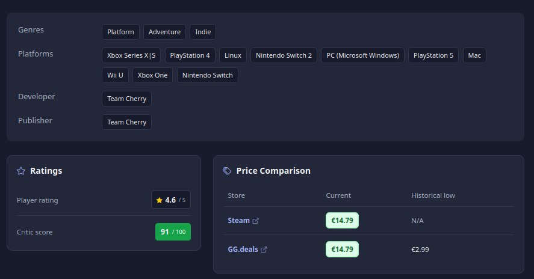
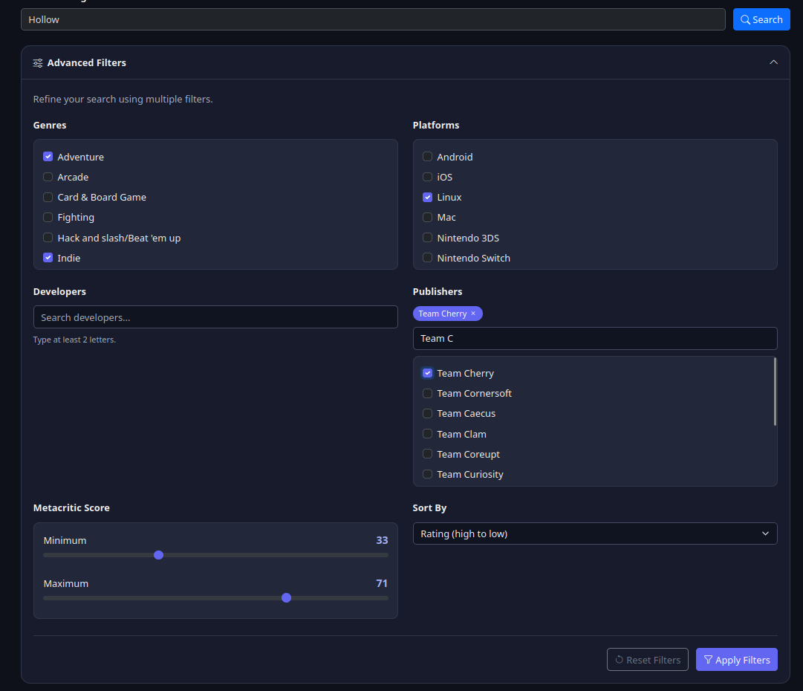
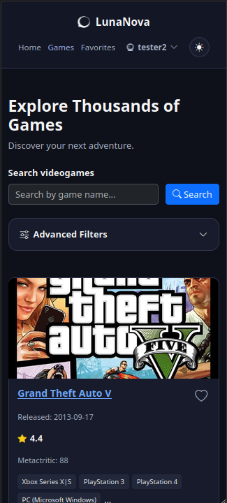

# LunaNova

**Find your next game, compare its prices, and keep track of your favorites.**

LunaNova is an open-source game discovery web app. Anyone can search a catalog of thousands of games, filter it by genre, platform, developer, publisher and critic score, open a detailed page for each game, and compare its current price across stores. Signed-in users can save games to their favorites and manage their account.

It was built for the **Terranova Software "Gaming Explorer" challenge** (Challenge – Episode 3) with ASP.NET Core, Angular and SQL Server.

> **Names used in this repository:** _LunaNova_ is the product name you see in the app. _Lune_ is the internal project name, used in the code (`Lune.Api`, `Lune.Games`, ...), the Docker project and the database. _Terranova_ (Terranova Software) is the client the challenge was set by.



## Contents

1. [Highlights](#highlights)
2. [Quick start](#quick-start)
3. [Evaluating the project](#evaluating-the-project)
4. [Tech stack](#tech-stack)
5. [Documentation](#documentation)
6. [Repository layout](#repository-layout)
7. [Team](#team)

---

## Highlights

**All mandatory features from the brief**, plus a set of bonus features. The full list, with where each one lives in the code, is in [docs/FEATURES.md](./docs/FEATURES.md).

|                                 |                                                                                                                                                                                |
| ------------------------------- | ------------------------------------------------------------------------------------------------------------------------------------------------------------------------------ |
| **Search**                      | Search by full or partial name, with suggestions as you type.                                                                                                                  |
| **Advanced filters**            | Genre, platform, developer, publisher, critic score range, and six sort orders. Filters combine with the search.                                                               |
| **Game pages**                  | Description, storyline, screenshot gallery, genres, platforms, developers, publishers, user rating and critic score, and related games.                                        |
| **Price comparison** _(bonus)_  | Current price and historical low from Steam and GG.deals for each game, with links to the stores.                                                                              |
| **Favorites**                   | Add and remove games from search results or a game page; a dedicated favorites page, stored in the database.                                                                   |
| **Accounts** _(bonus)_          | Register, log in, change your display name and delete your account, with ASP.NET Core Identity and a JWT in an HttpOnly cookie. Guests can browse everything except favorites. |
| **Dark / light mode** _(bonus)_ | Remembered between visits.                                                                                                                                                     |
| **Every state handled**         | Loading indicators, error messages, and "no results" messages across the app. Responsive from phone to desktop.                                                                |
| **Tested and documented API**   | An interactive API reference (Scalar) and an automated Bruno test suite of 79 requests, including error cases.                                                                 |

<p>
  
  
</p>

<p>
  
  
</p>

---

## Quick start

**You need:** [Docker Engine](https://docs.docker.com/engine/install/) with the Docker Compose plugin. Nothing else has to be installed to run the app.

**1. Configure.** Copy the example environment file:

``` bash
cp .env.example .env
```

Then fill in the values marked **REQUIRED** in `.env`:

| Variable                            | What it is                                                                                       | Where to get it                                                                                 |
| ----------------------------------- | ------------------------------------------------------------------------------------------------ | ----------------------------------------------------------------------------------------------- |
| `SA_PASSWORD`                       | Password for the local SQL Server: 8+ characters with upper and lower case, a digit and a symbol | Choose one                                                                                      |
| `JWT_SECRET`                        | Secret for signing login tokens, at least 32 characters                                          | `openssl rand -base64 48`                                                                       |
| `IGDB_CLIENT_ID`, `IGDB_API_SECRET` | Credentials for the game database (IGDB)                                                         | A free Twitch developer app: [IGDB getting started](https://api-docs.igdb.com/#getting-started) |
| `GGDEALS_API_KEY`                   | _Strongly recommended._ Adds GG.deals prices; without it, prices come from Steam only            | [gg.deals/api](https://gg.deals/api/)                                                           |

**2. Start.**

``` bash
docker compose up --build
```

The first start takes a few minutes. Docker downloads the images, installs packages, and the backend creates the database (migrations run automatically). The frontend starts once the backend reports it's ready.

**3. Open.**

|                                                                      | URL                                                      |
| -------------------------------------------------------------------- | -------------------------------------------------------- |
| **The app**                                                          | [http://localhost:8080](http://localhost:8080)           |
| API reference (Scalar)                                               | [http://localhost:3001/docs](http://localhost:3001/docs) |
| Backend landing page: every route, with quick register/login buttons | [http://localhost:3001](http://localhost:3001)           |

Stop with `Ctrl+C`, or `docker compose down`. Your data is kept between runs. For everyday development commands, running parts outside Docker, and troubleshooting, see the [contributor guide](./CONTRIBUTING.md).

---

## Evaluating the project

A suggested 10-minute tour, with the app running:

1. **Home page** ([localhost:8080](http://localhost:8080)): the featured games, then start typing in the search bar to see suggestions.
2. **Search and filters:** open the filters, pick a genre and a platform, narrow the critic score, change the sort order. Try a search with no results, too.
3. **A game page:** the gallery, the facts, the ratings and the price comparison. Scroll down to the related games.
4. **Favorites as a guest:** click a heart. You're asked to log in first.
5. **Register** a new account, then add a few favorites and open the **Favorites** page.
6. **Account page:** change your display name, or delete the account.
7. **Theme:** switch dark/light mode, then reload. The choice is remembered.
8. **Resize the window**, or use your browser's device toolbar, to see the mobile layout.

**For the API** (the brief's Postman requirement):

- Browse and try every endpoint in the **Scalar** reference at [localhost:3001/docs](http://localhost:3001/docs).
- Run the full **Bruno** test suite with one command. It needs Node.js and the Bruno CLI; setup is in [testing/README.md](./testing/README.md).

``` bash
cd testing/endpoint-testing/lune-reference-api && node run-tests.mjs
```

It writes an HTML report to `reports/`.

---

## Tech stack

| Layer                   | Technology                                                                              |
| ----------------------- | --------------------------------------------------------------------------------------- |
| Backend                 | C# / ASP.NET Core 10 (minimal APIs), split into modules: Auth, Games, Favorites, Prices |
| Frontend                | Angular 22, TypeScript, Bootstrap, RxJS                                                 |
| Database                | SQL Server 2022, Entity Framework Core (one schema per module, migrations at startup)   |
| Authentication          | ASP.NET Core Identity, JWT stored in an HttpOnly cookie                                 |
| External data           | IGDB (game data), Steam and GG.deals (prices)                                           |
| API docs and tests      | OpenAPI + Scalar, Bruno (OpenCollection format), Vitest for the frontend                |
| Development environment | Docker Compose with hot reload for the backend and frontend                             |

Why these choices were made, and how the pieces fit together: [docs/ARCHITECTURE.md](./docs/ARCHITECTURE.md).

---

## Documentation

| Document                                                 | What's in it                                                                        |
| -------------------------------------------------------- | ----------------------------------------------------------------------------------- |
| [docs/FEATURES.md](./docs/FEATURES.md)                   | Every feature, mapped to the brief's requirements, plus the engineering behind them |
| [docs/ARCHITECTURE.md](./docs/ARCHITECTURE.md)           | System and module architecture, technology choices, extensibility                   |
| [docs/API.md](./docs/API.md)                             | API overview: endpoints, authentication, conventions, error format                  |
| [docs/DATABASE.md](./docs/DATABASE.md)                   | Database schemas, tables and design decisions                                       |
| [docs/FUTURE.md](./docs/FUTURE.md)                       | Planned features and known limitations                                              |
| [testing/README.md](./testing/README.md)                 | Exploring the API with Scalar, the Bruno test suite, frontend unit tests            |
| [CONTRIBUTING.md](./CONTRIBUTING.md)                     | Developer guide: the Docker setup, everyday commands, editor setup, troubleshooting |
| [backend/README.md](./backend/README.md)                 | Backend modules, configuration, migrations and conventions                          |
| [frontend/README.md](./frontend/README.md)               | Frontend structure and scripts                                                      |
| `docs/openapi.json`                                      | The generated OpenAPI description of the API                                        |
| `docs/en.game_explorer.pdf`, `docs/it.game_explorer.pdf` | The original challenge brief (English, Italian)                                     |

---

## Repository layout

| Path                                                | What it is                                                                                                                                   |
| --------------------------------------------------- | -------------------------------------------------------------------------------------------------------------------------------------------- |
| `backend/`                                          | ASP.NET Core API: `Lune.Api` (host) and the `Lune.Auth`, `Lune.Games`, `Lune.Favorites`, `Lune.Prices` and `Lune.Shared` modules             |
| `frontend/`                                         | Angular app                                                                                                                                  |
| `docs/`                                             | Project documentation and the challenge brief                                                                                                |
| `testing/`                                          | Bruno API test suite and testing guide                                                                                                       |
| `mock-api/`                                         | An early in-memory mock of the API. Not maintained and not part of the build; see the [contributor guide](./CONTRIBUTING.md#project-layout). |
| `docker-compose.yml`, `docker-compose.override.yml` | Shared and development Docker configuration                                                                                                  |

---

## Team

| Name                 | Role                                |
| -------------------- | ----------------------------------- |
| Kelvin Lemayian      | Lead Frontend Developer             |
| Minoka Kakizaki      | Lead Backend Developer              |
| Francesca Frattaroli | Testing, Documentation & Deployment |

## AI Use

AI was used regularly for ideation, troubleshooting, documentation, script generation, and _some_ main codebase generation.
No agentic coding was used and all generated code and documentation was manually vetted and modified by hand before inclusion  into the project repo.
