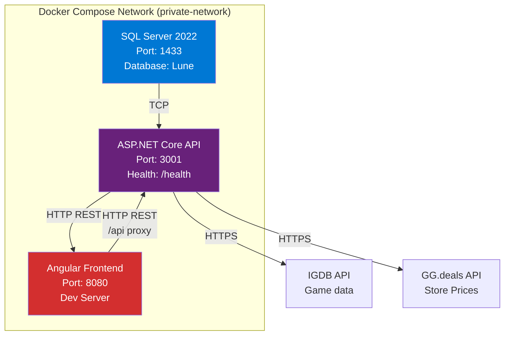
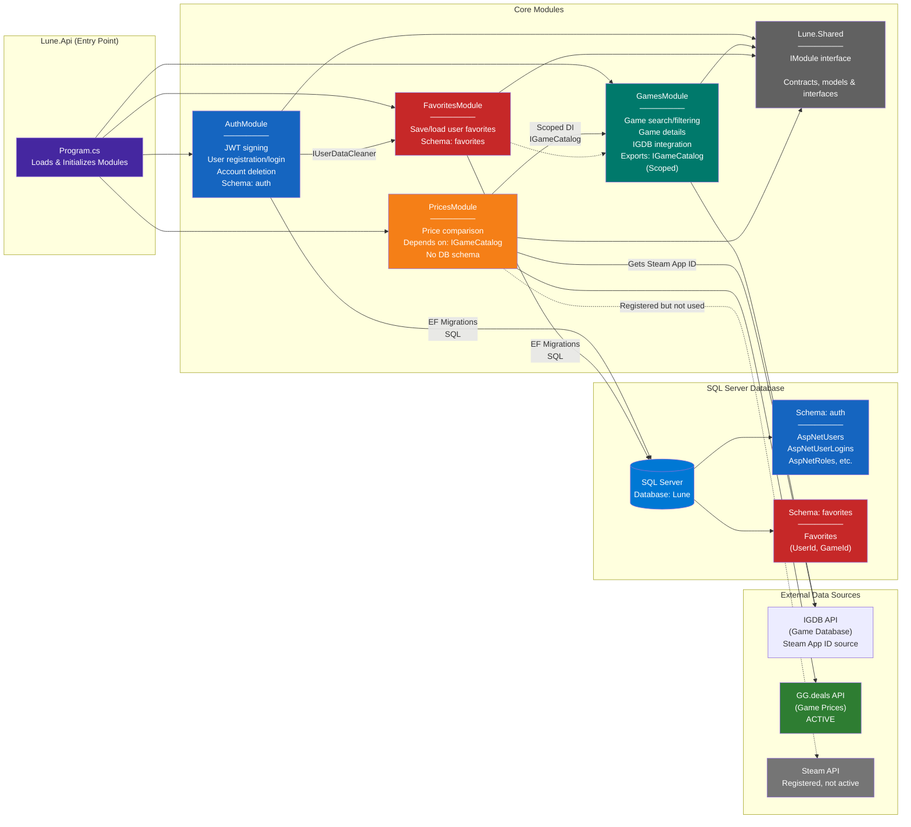
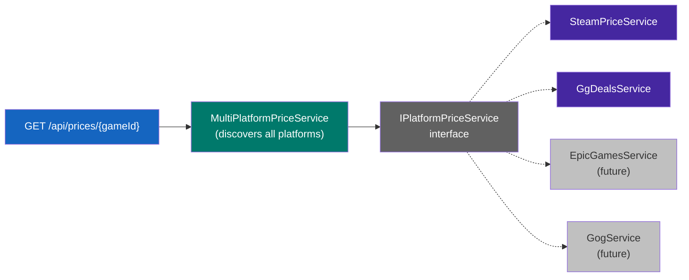

# Lunanova Architecture

Lunanova is a game discovery and price comparison platform built with **ASP.NET Core** (backend) and **Angular** (frontend), deployed via Docker.

## Design Philosophy

### Modular Backend

The backend follows a **modular architecture** where each feature owns its domain:

- **Loose coupling**: Modules communicate through shared interfaces, not direct dependencies
- **Independent data**: Each module owns its database schema and EF migrations
- **Plug-and-play**: New modules implement `IModule` (register services, map endpoints, initialize)
- **Extensibility**: Features like pricing use interface-based service registration, allowing new implementations without core changes

### Technology Choices

| Layer | Technology | Why |
|-------|-----------|-----|
| **Backend** | ASP.NET Core 10 (.NET SDK 10) | Type-safe, high-performance, modular with dependency injection |
| **Frontend** | Angular 22 | Component-based, reactive (RxJS), tested (Vitest), modern tooling |
| **Database** | SQL Server 2022 | Enterprise-grade, Schema-per-module isolation, EF Core integration |
| **Deployment** | Docker Compose | Local dev parity with production, service networking, easy reset |
| **Authentication** | JWT in HttpOnly cookies | CSRF-safe, works across subdomains, XSS-resistant storage |
| **Game Data** | IGDB (via Twitch OAuth) | Comprehensive game metadata, regular updates, free tier available |
| **Pricing Data** | GG.deals for current prices and historical lows; regional support (Italy) |

---

## Docker Deployment

### Container Architecture



### Services

| Service | Image | Port | Environment |
|---------|-------|------|-------------|
| **sqlserver** | `mcr.microsoft.com/mssql/server:2022-latest` | 1433 | `SA_PASSWORD`, `ACCEPT_EULA` |
| **backend** | Built from `backend/Dockerfile` | 3001 | API keys (RAWG, IGDB, GgDeals, Steam), JWT secret, DB connection |
| **frontend** | Built from `frontend/Dockerfile` | 8080 | `API_URL` (defaults to `http://backend:3001` from `.env`) |

### Networking

All containers connect via the **`private-network`** bridge:

- **Frontend → Backend**: Angular dev-server proxies `/api/*` requests to the backend service
  - Dev proxy config: `frontend/proxy.conf.js`
  - In-container URL: `http://backend:3001` (uses Docker service name)
  - Example: Angular calls `/api/games` → proxied to `http://backend:3001/api/games`

- **Backend → Database**: Direct TCP connection
  - Connection string (from env): `Server=sqlserver,1433;Database=Lune;User Id=sa;Password=...`

- **Backend → External APIs**: Outbound HTTPS over host network

### Database Setup

SQL Server starts with health checks (retries up to 12 times, 10s intervals). On first run:

1. Backend container waits for SQL Server health check to pass
2. Each module (Auth, Favorites) runs EF migrations at startup
3. Schemas created: `auth`, `favorites`
4. Data persists in the `sqlserver-data` volume

---

## Backend Module Architecture

The backend is built on a **plugin module system**. Each module:

1. Implements `IModule` interface (register services, map endpoints, initialize)
2. Owns one database schema
3. Communicates with other modules via shared interfaces
4. Registers with the main app in `Program.cs`

### Module Connections Diagram



### Module Details

#### AuthModule
- **Endpoints**: `/api/auth/register`, `/api/auth/login`, `/api/auth/logout`, `/api/auth/me`, `/api/auth/profile`, `/api/auth/delete-account`
- **Storage**: SQL Server schema `auth` (ASP.NET Identity tables)
- **Auth Method**: JWT in HttpOnly cookie (`Lune_auth`, 24-hour expiration)
- **Integrations**: Calls `IUserDataCleaner` implementations on account deletion (currently Favorites)

#### GamesModule
- **Endpoints**: `/api/games` (search), `/api/games/{id}`, `/api/games/featured`, `/api/games/filters`, `/api/companies`
- **Data Source**: IGDB (Internet Game Database) via Twitch OAuth token
- **Caching**: 24-hour in-memory cache for filter options (genres, platforms)
- **Exports**: `IGameCatalog` interface for other modules to look up game metadata, external store IDs (Steam, GOG, Epic, etc.)

#### FavoritesModule
- **Endpoints**: `/api/favorites` (list), `/api/favorites/{id}` (add/remove), `/api/favorites/ids`
- **Storage**: SQL Server schema `favorites` (one-per-user limit: 1,000)
- **Data Model**: Favorites store a snapshot of the game at save time (name, image, genres, platforms) + the IGDB game ID
- **Data Cleanup**: Implements `IUserDataCleaner` to delete all a user's favorites when account is deleted

#### PricesModule
- **Endpoints**: `/api/prices/{gameId}` (price comparison)
- **Data Flow**: 
  1. Look up game's **Steam App ID** via `IGameCatalog.FindExternalIdsAsync()` (from IGDB data)
  2. Use that Steam App ID to fetch prices from registered `IPlatformPriceService` implementations
  3. Return all available prices or 503 if none succeed
- **Currently Active**:
  - **GG.deals API** — Current price + historical low (Italian region)
- **Registered but Not Active**:
  - **Steam API** — API key configured but not currently fetching prices
- **Dependency Injection**: Receives `IGameCatalog` (Scoped) from Games module via DI container
- **Caching**: 6-hour in-memory cache per game
- **Error Handling**: If one platform fails, still return data from others

---

## Extensibility: Adding a New Price Service

The **PricesModule** is designed to scale to new price platforms without modifying the core API. 

### Architecture Pattern

Each price platform implements `IPlatformPriceService`:


### Adding a New Platform (e.g., Epic Games Store)

1. **Create a new service** in `backend/src/Lune.Prices/Services/ExternalServices/EpicGamesService.cs`:
   - Implement `IPlatformPriceService`
   - Make HTTP calls to Epic's API
   - Return `PlatformPrice` or null if game not found

2. **Add configuration** in `backend/src/Lune.Prices/Options/EpicGamesOptions.cs`:
   - Base URL, API key, cache duration, region

3. **Register in PricesModule** (`backend/src/Lune.Prices/PricesModule.cs`):
   ```csharp
   services.Configure<EpicGamesOptions>(configuration.GetSection(EpicGamesOptions.SectionName));
   services.AddHttpClient<EpicGamesService>();
   services.AddScoped<IPlatformPriceService>(sp => sp.GetRequiredService<EpicGamesService>());
   ```

4. **Add environment variables** to `.env.example` and `.env`:
   ```env
   EPIC_GAMES_API_KEY=...
   ```

5. **No other code changes needed** — the price endpoint automatically includes the new platform

### Extension Diagram



---


### API Communication

- **All requests** go through relative `/api/` paths
- **Development**: Angular dev-server proxy (configured in `proxy.conf.js`) forwards `/api` to `API_URL` env var
- **Production**: Frontend app is served from the same origin as `/api`, or a reverse proxy handles the routing
- **Authentication**: Cookies are automatically sent with all requests (browser default)


## Health & Monitoring

The backend exposes two health endpoints:

- **GET `/health`** — Liveness probe (process running?). Returns `"ok"` or 503.
- **GET `/health/ready`** — Readiness probe (database connected?). Returns 200 or 503 with status.

Docker Compose health checks use `/health` for the backend service; startup delay is 30s with 20 retries (100s max).

---


For detailed API contracts, see [docs/API.md](./API.md).  
For database schema, see [docs/DATABASE.md](./DATABASE.md).
