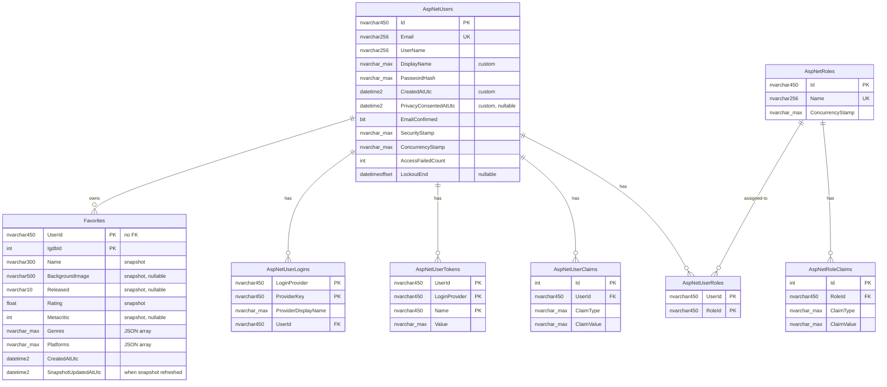

# Lune database schema

One SQL Server database (`Lune`). Each backend module owns its own **schema** and its own EF Core `DbContext` and migrations, which are applied automatically on startup. Each schema has its own `__EFMigrationsHistory` table.

| Module | SQL schema | Purpose |
|---|---|---|
| Auth | `auth` | User authentication, roles, and claims (ASP.NET Identity + custom fields) |
| Favorites | `favorites` | User game favorites with game data snapshots |
| Games | — | No database storage. Data sourced from IGDB API, cached in memory. |

## Architecture overview

**Game data** is not persisted in the database—it comes from the IGDB API and is cached in memory. When a user favorites a game, a **snapshot** of the game's metadata (name, image, rating, genres, platforms, release date) is stored in the `Favorites` table. This snapshot is updated periodically to reflect changes in IGDB without requiring the user to re-favorite.

**User identity and authorization** use ASP.NET Core Identity with standard tables (`AspNetUsers`, `AspNetRoles`, `AspNetUserRoles`, `AspNetUserClaims`, etc.) plus three custom columns on `AspNetUsers` for additional metadata.

The `Favorites` table references `AspNetUsers.Id` but **has no database foreign key**—modules are intentionally decoupled so each can move to its own database independently. The API layer enforces ownership by validating the user ID from the auth token.

## ER diagram



## Schema `auth` (ASP.NET Identity)

Standard ASP.NET Identity tables plus three custom columns on `AspNetUsers` for app-specific data.

### `auth.AspNetUsers`

| Column | Type | Null | Notes |
|---|---|:-:|---|
| `Id` | nvarchar(450) | No | **PK**, GUID string |
| `DisplayName` | nvarchar(max) | Yes | **Custom** |
| `CreatedAtUtc` | datetime2 | No | **Custom**, set at registration |
| `PrivacyConsentedAtUtc` | datetime2 | Yes | **Custom**, server-recorded UTC consent time; null for existing accounts |
| `UserName` | nvarchar(256) | Yes | Same as `Email` at registration |
| `NormalizedUserName` | nvarchar(256) | Yes | Uppercased. **Unique index** |
| `Email` | nvarchar(256) | Yes | |
| `NormalizedEmail` | nvarchar(256) | Yes | Uppercased. Index |
| `EmailConfirmed` | bit | No | Always false (no confirmation flow) |
| `PasswordHash` | nvarchar(max) | Yes | Salted PBKDF2 hash. Never the password. |
| `SecurityStamp` | nvarchar(max) | Yes | |
| `ConcurrencyStamp` | nvarchar(max) | Yes | |
| `PhoneNumber` | nvarchar(max) | Yes | Unused |
| `PhoneNumberConfirmed` | bit | No | Unused |
| `TwoFactorEnabled` | bit | No | Unused |
| `LockoutEnd` | datetimeoffset | Yes | Set after repeated failed logins |
| `LockoutEnabled` | bit | No | |
| `AccessFailedCount` | int | No | Failed logins since the last success |

Indexes: `PK_AspNetUsers (Id)`, `UserNameIndex (NormalizedUserName) UNIQUE WHERE NOT NULL`, `EmailIndex (NormalizedEmail)`.

### `auth.AspNetRoles`

Roles for authorization. Users are assigned roles via `AspNetUserRoles`.

| Column | Type | Null | Notes |
|---|---|:-:|---|
| `Id` | nvarchar(450) | No | **PK**, GUID string |
| `Name` | nvarchar(256) | Yes | Role name, e.g. "admin", "moderator" |
| `NormalizedName` | nvarchar(256) | Yes | Uppercased. **Unique index** `RoleNameIndex` |
| `ConcurrencyStamp` | nvarchar(max) | Yes | Optimistic concurrency control |

### `auth.AspNetUserRoles`

Junction table: assigns roles to users (many-to-many).

| Column | Type | Null | Notes |
|---|---|:-:|---|
| `UserId` | nvarchar(450) | No | **PK part 1**. FK → `AspNetUsers.Id` (cascade) |
| `RoleId` | nvarchar(450) | No | **PK part 2**. FK → `AspNetRoles.Id` (cascade) |

### `auth.AspNetUserClaims`

Custom claims attached to users. Claims are key-value pairs for fine-grained authorization (separate from roles).

| Column | Type | Null | Notes |
|---|---|:-:|---|
| `Id` | int | No | **PK**, identity |
| `UserId` | nvarchar(450) | No | **FK** → `AspNetUsers.Id` (cascade). Index `IX_AspNetUserClaims_UserId` |
| `ClaimType` | nvarchar(max) | Yes | e.g. "preferred_username", "email_verified" |
| `ClaimValue` | nvarchar(max) | Yes | The claim's value |

### `auth.AspNetRoleClaims`

Claims attached to roles. Any user with that role inherits the role's claims.

| Column | Type | Null | Notes |
|---|---|:-:|---|
| `Id` | int | No | **PK**, identity |
| `RoleId` | nvarchar(450) | No | **FK** → `AspNetRoles.Id` (cascade). Index `IX_AspNetRoleClaims_RoleId` |
| `ClaimType` | nvarchar(max) | Yes | The claim type |
| `ClaimValue` | nvarchar(max) | Yes | The claim's value |

### `auth.AspNetUserTokens`

Refresh tokens and other auth tokens stored per user. Used for OAuth and token-based authentication.

| Column | Type | Null | Notes |
|---|---|:-:|---|
| `UserId` | nvarchar(450) | No | **PK part 1**. FK → `AspNetUsers.Id` (cascade) |
| `LoginProvider` | nvarchar(450) | No | **PK part 2**. e.g. "GitHub", "Google", or provider name |
| `Name` | nvarchar(450) | No | **PK part 3**. e.g. "access_token", "refresh_token" |
| `Value` | nvarchar(max) | Yes | The token value |

Composite key ensures one token per (user, provider, name) tuple. Index `IX_AspNetUserTokens_UserId`.

### `auth.AspNetUserLogins`

External login credentials (e.g., GitHub OAuth). Reserved for third-party authentication.

| Column | Type | Null | Notes |
|---|---|:-:|---|
| `LoginProvider` | nvarchar(450) | No | **PK part 1**. e.g. "GitHub" |
| `ProviderKey` | nvarchar(450) | No | **PK part 2**. The external user ID (e.g. GitHub user ID) |
| `ProviderDisplayName` | nvarchar(max) | Yes | Display name from provider |
| `UserId` | nvarchar(450) | No | **FK** → `AspNetUsers.Id` (cascade). Index `IX_AspNetUserLogins_UserId` |

Composite key prevents duplicate logins. Currently not in use; reserved for GitHub OAuth integration.

## Schema `favorites`

### `favorites.Favorites`

Stores user-favorited games. Each row holds a **snapshot** of the game's metadata from IGDB at the time of favoriting. The snapshot is periodically refreshed so game data stays current (e.g., rating changes, new platforms added) without requiring the user to re-favorite.

| Column | Type | Null | Notes |
|---|---|:-:|---|
| `UserId` | nvarchar(450) | No | **PK part 1**. The `auth.AspNetUsers.Id` of the owner. **No FK**—modules are decoupled. |
| `IgdbId` | int | No | **PK part 2**. IGDB game ID. |
| **Snapshot columns** |
| `Name` | nvarchar(300) | No | Game name (truncated to 300 chars) |
| `BackgroundImage` | nvarchar(500) | Yes | Cover image URL (truncated to 500 chars, `null` if longer) |
| `Released` | nvarchar(10) | Yes | Release date in `yyyy-MM-dd` format |
| `Rating` | float | No | IGDB rating score |
| `Metacritic` | int | Yes | Metacritic score |
| `Genres` | nvarchar(max) | No | JSON array of strings, e.g. `["RPG","Action"]` |
| `Platforms` | nvarchar(max) | No | JSON array of platform names |
| **Tracking columns** |
| `CreatedAtUtc` | datetime2 | No | When the user favorited this game. Sorts the user's list newest-first. |
| `SnapshotUpdatedAtUtc` | datetime2 | No | When the snapshot was last refreshed from IGDB. Identifies rows stale enough to refresh. |

**Key design decisions:**

- **Snapshots are immutable at insert.** Snapshot columns are populated from IGDB when the game is favorited; the client never provides them.
- **Composite PK `(UserId, IgdbId)`** ensures a user can favorite each game at most once. Duplicate inserts are automatically rejected.
- **No foreign key on `UserId`.** Intentional decoupling: `favorites` schema can move to its own database without changing the auth schema. Consequences:
  - Deleting a user does *not* delete their favorites (delete-user feature does not exist yet).
  - Ownership is enforced by the API layer: the user ID is extracted from the auth token, never trusted from the client.
- **`SnapshotUpdatedAtUtc` drives refresh logic.** A periodic job (or explicit API call) can refresh stale snapshots by querying rows where `SnapshotUpdatedAtUtc < now - 7 days`, re-fetching from IGDB, and updating only the snapshot columns.
- **Limit: 1000 favorites per user.** Enforced in code, not in the database.
- **Index `IX_Favorites_IgdbId (IgdbId)`** (non-unique). Allows fast lookups of "all users who favorited this game" for analytics or cache invalidation.

## DDL reference (SQL Server)

### Core tables

```sql
CREATE SCHEMA auth;
GO
CREATE SCHEMA favorites;
GO

-- User identity with custom fields
CREATE TABLE auth.AspNetUsers (
    Id                   nvarchar(450)  NOT NULL CONSTRAINT PK_AspNetUsers PRIMARY KEY,
    DisplayName          nvarchar(max)  NULL,
    CreatedAtUtc         datetime2      NOT NULL,
    PrivacyConsentedAtUtc datetime2     NULL,
    UserName             nvarchar(256)  NULL,
    NormalizedUserName   nvarchar(256)  NULL UNIQUE,
    Email                nvarchar(256)  NULL,
    NormalizedEmail      nvarchar(256)  NULL,
    EmailConfirmed       bit            NOT NULL,
    PasswordHash         nvarchar(max)  NULL,
    SecurityStamp        nvarchar(max)  NULL,
    ConcurrencyStamp     nvarchar(max)  NULL,
    PhoneNumber          nvarchar(max)  NULL,
    PhoneNumberConfirmed bit            NOT NULL,
    TwoFactorEnabled     bit            NOT NULL,
    LockoutEnd           datetimeoffset NULL,
    LockoutEnabled       bit            NOT NULL,
    AccessFailedCount    int            NOT NULL
);
CREATE INDEX EmailIndex ON auth.AspNetUsers (NormalizedEmail);

-- Roles
CREATE TABLE auth.AspNetRoles (
    Id               nvarchar(450) NOT NULL CONSTRAINT PK_AspNetRoles PRIMARY KEY,
    Name             nvarchar(256) NULL UNIQUE,
    NormalizedName   nvarchar(256) NULL UNIQUE,
    ConcurrencyStamp nvarchar(max) NULL
);

-- User → Role assignments (many-to-many)
CREATE TABLE auth.AspNetUserRoles (
    UserId nvarchar(450) NOT NULL CONSTRAINT FK_AspNetUserRoles_AspNetUsers_UserId FOREIGN KEY REFERENCES auth.AspNetUsers(Id) ON DELETE CASCADE,
    RoleId nvarchar(450) NOT NULL CONSTRAINT FK_AspNetUserRoles_AspNetRoles_RoleId FOREIGN KEY REFERENCES auth.AspNetRoles(Id) ON DELETE CASCADE,
    CONSTRAINT PK_AspNetUserRoles PRIMARY KEY (UserId, RoleId)
);
CREATE INDEX IX_AspNetUserRoles_RoleId ON auth.AspNetUserRoles(RoleId);

-- User claims (authorization assertions)
CREATE TABLE auth.AspNetUserClaims (
    Id         int            NOT NULL IDENTITY(1,1) CONSTRAINT PK_AspNetUserClaims PRIMARY KEY,
    UserId     nvarchar(450)  NOT NULL CONSTRAINT FK_AspNetUserClaims_AspNetUsers_UserId FOREIGN KEY REFERENCES auth.AspNetUsers(Id) ON DELETE CASCADE,
    ClaimType  nvarchar(max)  NULL,
    ClaimValue nvarchar(max)  NULL
);
CREATE INDEX IX_AspNetUserClaims_UserId ON auth.AspNetUserClaims(UserId);

-- Role claims
CREATE TABLE auth.AspNetRoleClaims (
    Id         int           NOT NULL IDENTITY(1,1) CONSTRAINT PK_AspNetRoleClaims PRIMARY KEY,
    RoleId     nvarchar(450) NOT NULL CONSTRAINT FK_AspNetRoleClaims_AspNetRoles_RoleId FOREIGN KEY REFERENCES auth.AspNetRoles(Id) ON DELETE CASCADE,
    ClaimType  nvarchar(max) NULL,
    ClaimValue nvarchar(max) NULL
);
CREATE INDEX IX_AspNetRoleClaims_RoleId ON auth.AspNetRoleClaims(RoleId);

-- User tokens (refresh tokens, OAuth tokens)
CREATE TABLE auth.AspNetUserTokens (
    UserId        nvarchar(450) NOT NULL CONSTRAINT FK_AspNetUserTokens_AspNetUsers_UserId FOREIGN KEY REFERENCES auth.AspNetUsers(Id) ON DELETE CASCADE,
    LoginProvider nvarchar(450) NOT NULL,
    Name          nvarchar(450) NOT NULL,
    Value         nvarchar(max) NULL,
    CONSTRAINT PK_AspNetUserTokens PRIMARY KEY (UserId, LoginProvider, Name)
);

-- External logins (OAuth, social auth)
CREATE TABLE auth.AspNetUserLogins (
    LoginProvider       nvarchar(450) NOT NULL,
    ProviderKey         nvarchar(450) NOT NULL,
    ProviderDisplayName nvarchar(max) NULL,
    UserId              nvarchar(450) NOT NULL CONSTRAINT FK_AspNetUserLogins_AspNetUsers_UserId FOREIGN KEY REFERENCES auth.AspNetUsers(Id) ON DELETE CASCADE,
    CONSTRAINT PK_AspNetUserLogins PRIMARY KEY (LoginProvider, ProviderKey)
);
CREATE INDEX IX_AspNetUserLogins_UserId ON auth.AspNetUserLogins(UserId);

-- Favorited games with snapshots
CREATE TABLE favorites.Favorites (
    UserId              nvarchar(450) NOT NULL,
    IgdbId              int           NOT NULL,
    Name                nvarchar(300) NOT NULL,
    BackgroundImage     nvarchar(500) NULL,
    Released            nvarchar(10)  NULL,
    Rating              float         NOT NULL,
    Metacritic          int           NULL,
    Genres              nvarchar(max) NOT NULL,
    Platforms           nvarchar(max) NOT NULL,
    CreatedAtUtc        datetime2     NOT NULL,
    SnapshotUpdatedAtUtc datetime2    NOT NULL,
    CONSTRAINT PK_Favorites PRIMARY KEY (UserId, IgdbId)
);
CREATE INDEX IX_Favorites_IgdbId ON favorites.Favorites(IgdbId);
```

Complete migration scripts are in `backend/src/Lune.Auth/Data/Migrations/` and `backend/src/Lune.Favorites/Data/Migrations/`.

## Mock data model (simplified for frontend/integration testing)

A mock or test implementation only needs two collections and optionally roles/claims:

```ts
interface UserRow {
  id: string;                  // GUID
  email: string;               // unique, case-insensitive
  displayName: string | null;
  passwordHash: string;        // plain string is fine in a mock
  createdAtUtc: string;        // ISO 8601
  normalizedEmail: string;     // uppercase email
  accessFailedCount: number;
  lockoutEnd: string | null;   // ISO 8601 or null
  roles?: string[];            // role names, optional
  claims?: Record<string, string>; // claim type → value, optional
}

interface FavoriteRow {
  userId: string;              // composite key part 1
  igdbId: number;              // composite key part 2
  name: string;                // snapshot
  backgroundImage: string | null; // snapshot
  released: string | null;     // snapshot, "yyyy-MM-dd" format
  rating: number;              // snapshot
  metacritic: number | null;   // snapshot
  genres: string[];            // snapshot, JSON array
  platforms: string[];         // snapshot, JSON array
  createdAtUtc: string;        // ISO 8601, when favorited
  snapshotUpdatedAtUtc: string; // ISO 8601, when snapshot was refreshed
}
```

**Constraints to enforce:**

- **Unique email** (case-insensitive). Normalize by uppercasing for comparison.
- **Unique `(userId, igdbId)` pair.** A user can favorite each game only once.
- **`normalizedEmail`** is `email.toUpperCase()`.
- **Roles and claims are optional** for a basic mock. Add them if testing authorization.
- **Games are a static JSON file**, not in the database.
- **API response mapping**: `GET /favorites` returns `{ id: igdbId, name, backgroundImage, released, rating, metacritic, genres, platforms, addedAtUtc: createdAtUtc }`. The `userId` is never exposed.

**Snapshot refresh pattern (optional for advanced mocks):**

- On favorite: copy `name`, `rating`, `genres`, `platforms`, `released`, `metacritic`, `backgroundImage` from the IGDB API.
- Set `snapshotUpdatedAtUtc = now()`.
- To refresh stale snapshots: query rows where `snapshotUpdatedAtUtc < now() - 7 days`, re-fetch from the IGDB API, update only snapshot columns.

